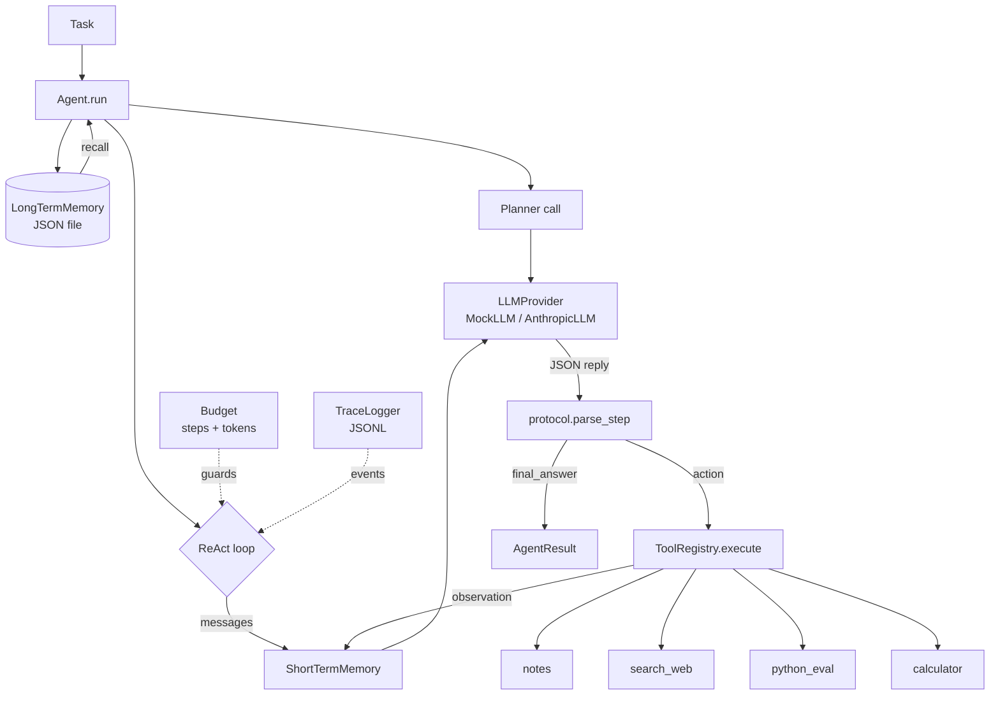

# Agentic Research Assistant

A small, dependency-light **ReAct-style tool-using agent framework** in Python: a planner + executor loop, a typed tool registry, short- and long-term memory, step/token budgets, structured JSON tracing, retry and error recovery, a pluggable LLM interface, and an offline eval harness.

Author: Chintada Rizvi Kumari (IIT Patna, CSE).

> **Honesty note.** The demo, the tests and the eval suite all use a **deterministic scripted mock LLM** (`MockLLM`, an alias of `ScriptedLLM`). They verify the *framework* (parsing, tool execution, recovery, budgets, memory, tracing). They say nothing about how well any real language model would do on these tasks. `AnthropicLLM` is provided for real use but is **not exercised by the tests or the demo** (no network or API key was available).

## Problem statement

LLM agents fail in boring, systemic ways: a model emits malformed JSON, calls a tool that does not exist, passes bad arguments, loops forever, blows the token budget, or a provider returns a 429. This project builds the surrounding runtime so those failure modes are contained, observable and testable without calling a real model.

## Features

- **ReAct loop with an up-front planner**: one planning call, then think / act / observe until a final answer.
- **Typed tool registry**: each tool declares a Pydantic argument model; arguments are validated before execution, and `execute()` never raises (unknown tool, bad args and tool exceptions all return `ok=False` observations the model can react to).
- **Built-in tools**
  - `calculator`: arithmetic via an `ast` whitelist interpreter (no `eval`).
  - `python_eval`: sandboxed single-expression Python (comprehensions, containers, whitelisted builtins), also via `ast`.
  - `search_web`: offline stub doing BM25 ranking over a small local corpus (6 short documents).
  - `notes`: write / append / read / list markdown notes, with slugified names that cannot escape the notes directory.
- **Memory**: bounded short-term conversation window (pinned system/task messages never evicted, role alternation preserved); long-term JSON fact store with atomic writes, keyword-overlap recall, and recovery from a corrupt file.
- **Budgets**: max steps and max tokens per run, terminating with status `budget_exceeded`.
- **Loop guard**: identical tool calls repeated too often end the run as `stuck`.
- **Retry / recovery**: transient tool errors retried with exponential backoff; transient LLM errors retried; malformed model replies get a corrective message and a retry; planner failure falls back to no plan.
- **Structured tracing**: every event is a JSON object (`run_id`, `seq`, `ts`, `type`, `data`), optionally appended to a JSONL file.
- **LLM provider interface** (`LLMProvider` protocol), a scripted `MockLLM`, and an optional `AnthropicLLM` that lazily imports the `anthropic` SDK and reads `ANTHROPIC_API_KEY` from the environment (nothing is hard-coded).
- **Eval harness**: 12 tasks with pass/fail scoring on status, answer content, required tools and minimum recovered errors.

## Architecture



| Component | File | Responsibility |
|---|---|---|
| `Agent`, `AgentConfig`, `AgentResult` | `agent.py` | Planner + executor loop, retries, loop guard, terminal statuses |
| Protocol | `protocol.py` | One-JSON-object-per-reply schema (Pydantic), tolerant JSON extraction |
| `LLMProvider`, `ScriptedLLM`/`MockLLM`, `AnthropicLLM` | `llm.py` | Provider interface, deterministic mock, optional real client |
| `Tool`, `ToolRegistry` | `tools.py` | Typed tools, validation, retry/backoff, uniform error results, output clipping |
| Built-in tools | `builtin_tools.py` | Wiring of the four tools |
| `SafeEvaluator` | `sandbox.py` | AST interpreter with whitelist and resource limits |
| `LocalCorpus` | `search.py` | BM25 search over `data/corpus/*.txt` |
| `NotesStore` | `notes.py` | Path-safe file notes |
| `ShortTermMemory`, `LongTermMemory` | `memory.py` | Conversation window; persistent facts |
| `Budget` | `budget.py` | Step and token accounting |
| `TraceLogger` | `trace.py` | Structured JSON(L) events |
| Evals | `evals.py` | Task set, scoring, report, CLI |

## Design decisions and trade-offs

- **AST interpreter instead of `eval`.** Restricted-builtins `eval` is a well-known escape risk. The evaluator interprets only whitelisted node types and named functions; attribute access, lambdas, imports and f-strings do not exist in it. Guards cap expression length, evaluation steps, `range` size, exponent size and sequence repetition. Trade-off: less expressive than real Python, and it is an in-process guard, not an OS-level sandbox (see Limitations).
- **Tools never raise.** Errors become observations so the model can self-correct; the cost is that a buggy tool shows up as a failed call rather than a crash (the trace records it).
- **Plain JSON protocol, not provider-native tool calling.** Keeps the loop provider-agnostic and trivially mockable. Trade-off: native tool-use APIs are more reliable for real models, and `AnthropicLLM` does not use them.
- **Token accounting is an estimate for the mock** (about 4 characters per token); real usage numbers are used by `AnthropicLLM`.
- **Memory recall is keyword overlap**, not embeddings: deterministic, zero-dependency, weaker semantically.
- **Search is a stub** over a tiny corpus so the loop is testable offline; the tool interface is what a real search backend would implement.

## How to run

Tested with Python 3.13 on Linux; runtime dependency is `pydantic`, dev dependency is `pytest`.

```bash
pip install -r requirements-dev.txt     # pydantic + pytest (already installed? skip)
python examples/demo.py                 # scripted end-to-end demo, no network
PYTHONPATH=src python -m research_agent.evals [--report eval_report.json]
python -m pytest -q                     # pythonpath is configured in pyproject.toml
```

Using a real model (not exercised here):

```python
import os
from research_agent import Agent, AnthropicLLM
from research_agent.builtin_tools import default_registry

# needs `pip install anthropic`, ANTHROPIC_API_KEY set, and a model name you choose
llm = AnthropicLLM(model=os.environ["ANTHROPIC_MODEL"])
print(Agent(llm, default_registry("notes")).run("How tall is Mount Everest?").answer)
```

## Results (real output from this repo)

**Tests**

```
$ python -m pytest -q
.............................................                            [100%]
45 passed in 0.39s
```

**Eval suite** (`PYTHONPATH=src python -m research_agent.evals`). Every task is driven by a scripted mock model, so 12/12 means the framework handled each scripted scenario correctly, including recovery from a bad expression, an unknown tool, a malformed reply and a transient LLM error, plus step-budget and stuck-loop termination. Token counts are the mock's character-based estimates.

```
task                           result status           steps tokens  tools
calc_basic                     PASS   success              2    630  calculator
search_everest                 PASS   success              2    735  search_web
search_two_then_calc           PASS   success              4   1775  search_web,search_web,calculator
python_sum_even_squares        PASS   success              2    657  python_eval
notes_roundtrip                PASS   success              3    994  notes,notes
recover_bad_expression         PASS   success              3    934  calculator,calculator
recover_unknown_tool           PASS   success              3    962  math_solver,calculator
recover_malformed_reply        PASS   success              2    926  calculator
recover_transient_llm_error    PASS   success              2    616  calculator
sandbox_blocks_escape          PASS   success              2    665  python_eval
budget_stops_runaway           PASS   budget_exceeded      3    925  calculator,calculator,calculator
stuck_detection                PASS   stuck                3    917  calculator,calculator

12/12 tasks passed (scripted MockLLM; measures the framework, not a real model)
```

**Demo** (`python examples/demo.py`) shows the planner, two searches, a deliberately mistyped calculator call that fails and is retried correctly, a note write, a JSONL trace file and a stored long-term memory fact. The "model" is the scripted mock.

## Limitations

- No real LLM was run: model quality, prompt robustness and real-world tool-use accuracy are untested. `AnthropicLLM` has never been executed against the API here.
- The eval tasks are few (12) and scripted, so they cannot measure model capability; they are regression checks for the runtime.
- The Python sandbox is an interpreter-level whitelist with resource guards, not process isolation; it is not a security boundary for hostile code. Very deep nesting or heavy builtin calls can still consume CPU.
- Search covers six short documents and has no network access; BM25 and keyword recall are lexical only.
- Stuck detection only catches exact repeats of the same call.
- Single-threaded and synchronous; no streaming or concurrency.
- Package metadata declares Python >= 3.11, but only 3.13 was tested.
